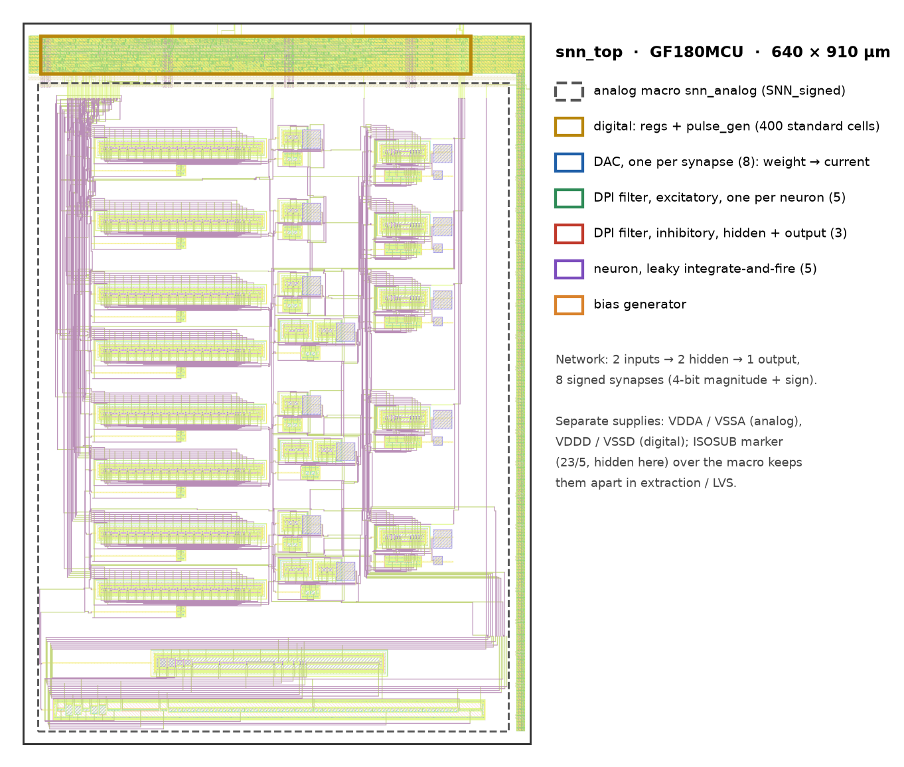
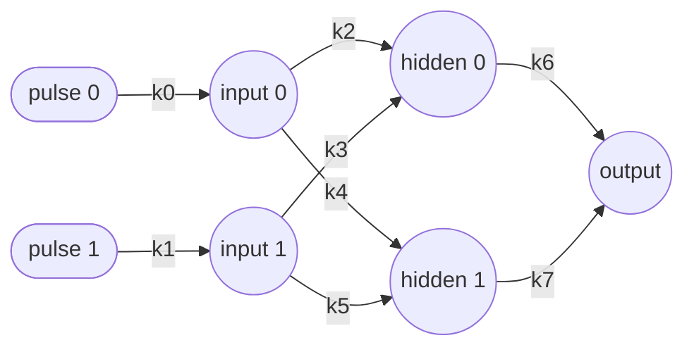

# ENGN 2912E Final Project: a mixed-signal spiking neural network chip

`snn_top` is a small mixed-signal spiking neural network (SNN) for GF180MCU (3.3 V devices):
an analog 2-2-1 network of leaky integrate-and-fire neurons with 8 signed synapses, and the
digital interface that loads the weights and generates the input spike trains.

Signoff state of the chip (layout, every check, how to re-run them): [signoff/](signoff/README.md).
Pins, supplies and the power-up / test procedure: [PINLIST.md](PINLIST.md).

## Architecture



The chip is 640 × 910 µm. The analog macro takes up most of it (0.49 of 0.58 mm²); the digital
logic is a strip of about 400 standard cells along the top edge. The macro is placed flipped (`FS`)
so its pin edge faces the logic: the 42 control wires (`w[31:0]`, `s[7:0]`, `pulse[1:0]`) enter at
its top left, and the five spikes leave at its top right, straight to the `out[4:0]` pins.
`snn_top.v` only wires the two parts together.

### Digital: `snn_digital` (`digital/`)

Placed and routed with LibreLane at a 1 MHz clock.

**`regs`: register map.** On every rising `clk` edge, `data[3:0]` is written to the register at
`addr[3:0]`, unless `addr = 4'hF` (idle). There is no write-enable pin. To write: rest at `4'hF`,
set `data`, set `addr` for one cycle, return to `4'hF`, and change `data` only while idle.

| addr | register | reset |
|---|---|---|
| 0–7 | weight magnitude of synapse k (0–15) | none |
| 8, 9 | signs of synapses 3–0, 7–4 (1 = inhibitory) | none |
| 10, 11 | pulse period [3:0], [7:4] (clk cycles) | 200 |
| 12, 13 | pulse width [3:0], [7:4] (clk cycles) | 10 |
| 14 | input enable `in[1:0]` (`data[3:2]` ignored) | 00 |
| 15 | idle: no write | |

`rst` resets only the pulse timing and the input enables; weights and signs must be written
before use.

**`pulse_gen`: input spike trains.** Two channels share one counter. Each period, a channel whose
enable was high at the end of the previous period outputs one pulse of `width` cycles. Enables,
period and width are sampled only at period boundaries, so a pulse is never cut or stretched.
The reset values give one 10 µs pulse every 200 µs (5 kHz) at 1 MHz, the rate the neurons and
synapses are sized for. The 8-bit period limits `clk` to about 1.3 MHz at that rate.

### Analog: the `SNN_signed` macro (`analog/`)



Synapse k has magnitude `w[4k+3:4k]` (0–15) and sign `s[k]` (1 = inhibitory). Inside the macro:

- each synapse has a **DAC** (`analog/DAC/DAC.sch`, binary 1:2:4:8 core `DAC_magnitude`) that
  turns its weight into a current while the presynaptic spike is high, and steers it to the
  excitatory or inhibitory input by its sign;
- each neuron has a **DPI filter** (`analog/DPI/DPI.sch`) that sums and smooths its excitatory
  currents. Hidden and output neurons also have an inhibitory DPI (`DPI_inh.sch`) that removes
  charge from the membrane. The input neurons have none, so a negative weight on k0 or k1 switches
  that synapse off;
- a **neuron** (`analog/neuron/neuron.sch`, with `spike_amplifier.sch` as its comparator)
  integrates against a leak and fires when the membrane reaches `VT`;
- a **bias cell** (`analog/neuron/bias.sch`) derives every bias from the off-chip reference
  current `Iref` (100 nA). `VT` (1.66 V) is a second analog pin.

The network schematic is `analog/snn/snn_analog_signed.sch`; `analog/layout_tools/` lays out
each cell (`flow.py`) and assembles the macro `SNN_signed` (`top.py`), which
`librelane/macros/snn_analog/` wraps for LibreLane. Its Verilog black box is
`analog/snn/snn_analog.v`.

### Supplies

`VDDA`/`VSSA` (analog) and `VDDD`/`VSSD` (digital) are separate nets and pads, so digital
switching noise stays off the analog supply. Both grounds sit on the same p-substrate, so the
macro carries an `ISOSUB` marker (GDS 23/5) that keeps extraction from merging them; it is read
only by the LVS decks, and no mask is made from it.

## What is where

**On the chip:**

| Path | Contents |
|---|---|
| `snn_top.v` | chip top: `snn_digital` + `snn_analog` |
| `digital/` | `snn_digital` RTL (`regs`, `pulse_gen`) and its testbench |
| `analog/DAC/`, `analog/DPI/`, `analog/neuron/`, `analog/snn/` | schematics of the macro's cells and network; `snn_analog.v` black box |
| `analog/layout_tools/` | layout of the cells (`flow/`) and of the macro (`top/SNN_signed/`) |
| `librelane/` | the chip build: macro wrapper (`macros/snn_analog/`), LibreLane config, chip LVS, gate-level simulations (`snn_top/gls`, `snn_top/gls_ms`) |
| `gds/`, `verilog/gl/`, `info.yaml`, `lvs_config.json` | published chip layout and netlist, and the submission metadata |
| `PINLIST.md` | pins, supplies, power-up and test procedure |

**Verification:** `signoff/` (chip-level results and `run_checks.sh`), `mixed/` (RTL + macro in
ngspice), `analog/testbenches/` (cell and network characterization).

**Not on the chip:** [`explore/`](explore/README.md) (design exploration, and where earlier
designs went), [`ai/`](ai/README.md) (specs given to the AI and the AI records), `slides/`,
`docs/` (export-control forms), `tools/` (waveform and power plot scripts).

## Build and verification flow

Inside the IIC-OSIC-TOOLS container, from the repo root. Each step's output is the next one's
input, so after a change rerun from the step that changed, then everything below it. The layout
steps need the gLayout environment ([analog/layout_tools/](analog/layout_tools/README.md)):

```sh
F="env -u PYTHONPATH PDK_ROOT=/foss/pdks .venv-glayout/bin/python analog/layout_tools/flow.py"
T="env -u PYTHONPATH PDK_ROOT=/foss/pdks .venv-glayout/bin/python analog/layout_tools/top.py"
```

| # | Step | Command | Writes |
|---|---|---|---|
| 1 | Digital RTL test | `cd digital && iverilog -g2012 -Wall -o sim.vvp tb_snn_digital.v snn_digital.v regs.v pulse_gen.v && vvp sim.vvp` | 12 checks, PASS |
| 2 | Cell layouts: DRC, LVS, PEX | `for c in DAC DPI DPI_inh neuron bias; do $F run $c; done` | `analog/layout_tools/flow/<cell>/` |
| 3 | Macro layout: DRC, LVS | `$T run SNN_signed` | `analog/layout_tools/top/SNN_signed/` |
| 4 | Macro extraction | `bash analog/layout_tools/top_pex.sh SNN_signed` | `top/SNN_signed/pex/SNN_signed_pex.spice` |
| 5 | Network, analog only | `python3 analog/testbenches/snn/run_snn_signed.py` and `--pex` | scenario reports in `analog/testbenches/snn/results/`; `--pex` also writes `pex/SNN_signed_pex_sim.spice`, which steps 6 and 10 need |
| 6 | Mixed-signal, RTL + macro | `make -C mixed run` (pre-layout macro) and `make -C mixed run PEX=1` (post-layout) | `mixed/snn_ms_tb[_pex].log` |
| 7 | Macro for LibreLane | `cd librelane/macros/snn_analog && python3 make_macro.py` | `snn_analog.gds/.lef`, `snn_analog_lvs_ref.spice` |
| 8 | Chip place and route | `librelane/snn_top/run.sh` | `librelane/snn_top/results/`, `gds/snn_top.gds`, `verilog/gl/snn_top.v` |
| 9 | Full-chip LVS | `python3 librelane/snn_top/chip_lvs.py` | `librelane/snn_top/chip_lvs/summary.txt` |
| 10 | Gate-level simulations | `make -C librelane/snn_top/gls`; `make -C librelane/snn_top/gls_ms run` and `run PEX=1` | timing: 4 × 20 checks; mixed-signal: 8 scenarios each |
| 11 | Collect signoff results | `signoff/run_checks.sh --spice` (reruns 9–10 except the pre-layout `gls_ms`) | `signoff/results/` |

Notes:
- Step 8: until fill is added, LibreLane exits non-zero on the 27 `DCF.1a` errors and `run.sh`
  skips its copy step; copy the run's `final/` files by hand (the paths are in `run.sh`).
- Step 9 also checks that every link of the chain is current, and names the step to rerun if not;
  `--layout <gds>` checks a candidate GDS before publishing.
- Cell characterization (`analog/testbenches/`) is verification, not part of the chain: rerun it
  when a cell's schematic changes.

## TODO

### Tape-out
- [ ] Fill for the 27 KLayout `DCF.1a` (COMP density) errors.
- [ ] Confirm with the organisers that their precheck accepts the `ISOSUB` marker (23/5) in the
  submitted GDS.
- [ ] Pad-ring integration (21 pads, [PINLIST.md](PINLIST.md)); confirm the pad limit.
- [ ] Optional: a hand-written liberty file for the macro.

### Analog
- [ ] Post-layout, the input neurons fire about 2.7× as often as in the schematic (49–56 spikes
  per scenario against 16–21). The DAC's internal nodes drain while `en` is low and refill from
  `Isum` at each enable. Candidate fix: steer the current to VDD while `en` is low (macro and
  chip rebuild). All 8 scenarios still pass post-layout
  ([diagnosis](analog/testbenches/snn/results/snn_signed_pex_diagnosis.md)).
- [ ] Scenarios 5 and 7 (−15 against +15) are a near tie: they pass all process corners, and
  93 / 100 post-layout Monte Carlo chips pass both
  ([report](analog/testbenches/snn/results/snn_signed_tb__pex__mc100.md)). Accept, or add margin.
- [ ] The cell runners' `--pex` option is broken: `tbpex.py` expects extractions made by the
  hand-layout era's `extract.sh` (`explore/hand_layout/PEX/`), which cannot find the current
  layouts. Point it at the flow's own `analog/layout_tools/flow/<cell>/<cell>_pex.spice`.

### Mixed-signal
- [ ] The network has no membrane reset: after the 4 ms `SETTLE` some membranes still hold up to
  ~0.3 V (threshold ~1.6 V). On the chip, wait at least 8 ms with the inputs off between test
  cases ([PINLIST.md](PINLIST.md) §5), or add a reset switch on VMEM (analog change, full
  rebuild).
- [ ] Add intermediate-weight scenarios and mixed-signal corners.

### Docs
- [ ] Add the timeline and division of responsibilities.
