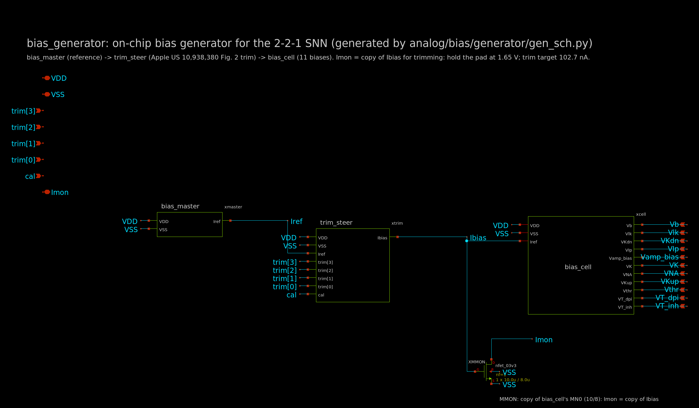
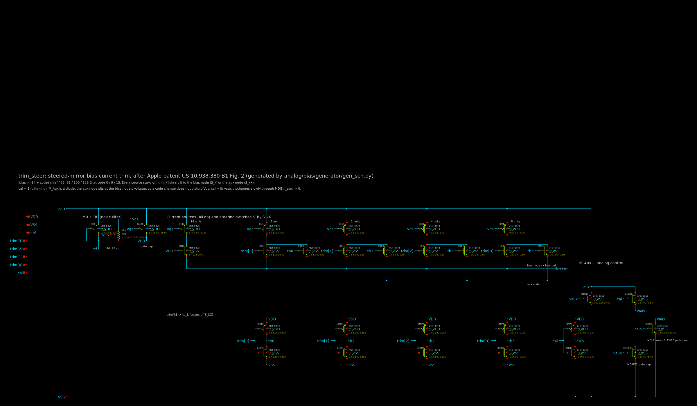

# `bias_generator`: on-chip bias generator with steered-mirror trim

One block that makes all 11 bias voltages of the 2-2-1 network on chip, from a supply and a 4-bit trim code. It is built from three cells:

```
             ┌──────────────┐  Iref 100 nA  ┌──────────────────────────────┐  Ibias  ┌───────────┐
 VDD ───────►│ bias_master  │──────────────►│ trim_steer                   │────────►│ bias_cell │──► Vb Vlk VKdn VIp Vamp_bias
             │ (reference)  │               │ (Apple US 10,938,380 Fig. 2) │         │ (team's,  │    VK VNA VKup Vthr VT_dpi VT_inh
             └──────────────┘               └──────────────────────────────┘         │ unchanged)│
                              trim[3:0], cal ──────────┘                    │         └───────────┘
                                                                            └── MMON ──► Imon pad (copy of Ibias)
```

- Pins: `VDD VSS trim[3] trim[2] trim[1] trim[0] cal Imon`, then the 11 biases in `bias_cell`'s order.
- Supply: 1.29 µA at 3.3 V, of which `bias_cell` takes 0.72 µA. Add 26 nA while `cal` = 1, and 0.1 µA into the Imon pad while it is measured.
- `trim[3:0]` comes from the trim register (address 12 in `mixed/addr4_trim/regs_v2.v`, reset value 9 = nominal). `cal` can come from a spare register bit (for example debug register 0, address 13, reset 0). Tie it to VSS if it is not used: trimming still works, only without the glitch protection.
- Schematics: `bias_generator.sch` (top), `bias_master.sch`, `trim_steer.sch`, and `bias_cell` from `analog/neuron/`. Testbench: `bias_generator_tb.sch`.



## The existing `bias_cell` (what this block feeds)

`analog/neuron/bias_cell.sch` is the team's current-mode bias cell, already laid out in `SNN.gds`. It needs one input current, `Iref` = 100 nA, and turns it into the 11 bias voltages:

1. **Input diode.** `MN0` (nFET 10/8 µm, diode-connected) sinks Iref. `MNP` copies it into `MP0`, a pFET diode, so the cell has both an nFET gate line (`Iref`) and a pFET gate line (`vgp`).
2. **One branch per bias.** Each output is a current source sized for that bias's current (a ratio of Iref), feeding a **diode-connected replica** of the transistor the pin drives in the network. nFET-driven pins (`Vb`, `Vlk`, `VKdn`, `VIp`, `Vamp_bias`, `VK`) are fed from `vgp`; pFET-driven pins (`VNA`, `VKup`, `Vthr`, `VT_dpi`, `VT_inh`) are pulled from `Iref`.
3. **Why replicas.** A replica has the same type, size and rail as the device it biases, so the voltage tracks process and temperature. The team's results (`analog/testbenches/bias/results/bias_cell.md`): with fixed voltages the neuron meets its specs at 1 of 15 corner/temperature points and the DPI gain swings 137×; from the cell, the DPI gain swings 1.8×.
4. **What it does not have.** No reference and no trim: the testbenches drive Iref with an ideal source, and `mixed/addr4_trim` with a Verilog-A model (`trim_iref.va`). This generator supplies that current on chip.

## How it works

1. **Reference (`bias_master`).** A subthreshold beta multiplier: M1 (8 units) and M2 (64 units, K = 8) are nFETs in weak inversion, and M3 = M4 (4 units) are a pFET mirror. All units are 1/6 µm.
   - The loop settles where the voltage across R is n·UT·ln(K), so I0 = n·UT·ln(K)/R = 200 nA.
   - R is an n-well resistor, 2 µm wide and 585 µm long (292.7 squares). Its +2900 ppm/K nearly cancels UT's +3300 ppm/K, so I0 is flat with temperature.
   - Start-up: MS1 (four 0.22/50 µm pFETs in series, always on) pulls X up while the loop is off, and MS3 pulls Vgp down. Once the loop runs, MS2 holds X at VSS.
   - MREF (4 of M1's 8 units) sinks **Iref = 100 nA**, the patent's "reference current source".
2. **Trim (`trim_steer`), after Apple's patent US 10,938,380 B1 (Fayazi et al., 2021), Fig. 2.**
   - **M0**: a diode-connected pFET (23 units) carries Iref. **R0** (n-well, 75 squares, about 100 kΩ) joins M0's gate to the current-source gate line `Vgs`. With the 10×10 µm gate cap `MCG`, it filters M0's noise (patent claim 4).
   - **Current sources**: `MB` (14 units) always feeds the bias node, through an always-on switch `SB`, so it has the same drop as the others. M1–M4 (1, 2, 4, 8 units) each feed a complementary switch pair: **S_k** to the bias node when `trim[k]` = 1, **S_kX** to the auxiliary node when `trim[k]` = 0. Inverters make the `tb_k` gates.
   - Every source stays on, so a code change only moves current between the two nodes, and the gate line `Vgs` hardly moves. That is the patent's point.
   - **Ibias = (14 + code) × Iref / 23**, so 100 nA at code 9, 60.9 nA at code 0 and 126.1 nA at code 15, in exact steps of 4.35 nA.
   - **Aux path (M_Aux plus the analog control, patent claims 5–6).** M_Aux is an nFET the size of `bias_cell`'s MN0. While `cal` = 1, MCAL ties its gate to its drain: it is a diode, so the aux node sits at the same voltage as the bias node, and a source sees no change in drain voltage when it is steered. When `cal` goes to 0, MCAL opens and the weak pull-down MDIS (0.22/20 µm) discharges the gate cap MCAUX slowly, so the aux current fades to zero instead of stepping.
   - Switches are nFETs (1/0.5 µm): the bias node sits at about 0.6 V, too low for a pFET switch to turn on.
3. **Distribution (`bias_cell`)**, as above, unchanged.
4. **Imon (`MMON`).** An nFET 10/8 µm, the same as `bias_cell`'s MN0, with its gate on the bias node. It sinks a copy of the *trimmed* Ibias from the Imon pad.



## Results (tt, 27 °C, code 9, `cal` = 0 unless stated)

Simulated in ngspice on `biasgen.spice`, where every unit is its own device, so the Monte Carlo is meaningful.

1. **Nominal.** Ibias = 100.00 nA. Every bias equals its value from an ideal 100 nA source to 0.01 mV: Vb 0.616, Vlk 0.425, VKdn 0.588, VIp 0.573, Vamp_bias 0.535, VK 1.220, VNA 1.930, VKup 2.350, Vthr 2.909, VT_dpi 2.900, VT_inh 2.790 V.
2. **Trim law.** Ibias is within 0.01 % of (14 + code) × 4.348 nA at every code, monotonic and linear (Vb 0.592 V at code 0 to 0.628 V at code 15).
3. **Process and temperature, after trim.** Untrimmed Ibias is 79–81 nA at ss and 125–129 nA at ff. The code whose Imon is closest to 102.7 nA (see "Trimming") is 14–15 at ss, 4 at ff and 9–10 elsewhere. That puts Ibias within −1.9 % / +2.1 % at all 5 corners × 0 / 27 / 85 °C.
   - A chip trimmed once at 27 °C stays within −3.3 % / +1.0 % from 0 to 85 °C.
4. **Supply.** Ibias 98.2 nA at 2.97 V and 102.7 nA at 3.63 V (±10 %).
5. **Start-up.** Supply ramps of 10 ns, 1 µs, 100 µs and 10 ms, all nodes from 0 V, 5 corners × 0 / 27 / 85 °C: 60 / 60 settle within 1 %.
6. **Mismatch** (200 samples). Untrimmed Ibias σ = 3.9 %, mostly the reference. Imon tracks Ibias with σ = 1.8 % (MMON vs MN0), which with the ±2.2 % code step leaves σ = 2.2 % after trimming.
7. **The patent's effect** (`--glitch`: code 7 → 8, every bit flips, at 50 µs):
   - With `cal` = 1 the source gate line `Vgs` moves 0.1 mV; with `cal` = 0 it moves 5.1 mV, 50× more.
   - At `bias_cell`'s output the difference is small: Vb moves transiently by up to 3.9 mV (`cal` = 1) or 2.5 mV (`cal` = 0) before settling, mostly from the switches' charge injection.
   - When `cal` then goes 1 → 0, the aux current fades from 30 nA to 5 pA and Vb moves by at most 1.2 mV.
8. **Schematic = simulated circuit.** `bias_generator.sch`, netlisted by xschem, was checked against `biasgen.spice` at 5 points: Ibias agrees to 0.001 %, every bias to 0.02 mV.

## Trimming a chip

1. Set `cal` = 1 (optional: it makes the code changes glitch-free).
2. Hold the Imon pad at 1.65 V and measure its current.
3. Write codes to the trim register until Imon is closest to **102.7 nA**. Not 100 nA: MMON's drain sits at 1.65 V and MN0's at 0.6 V, so the copy reads 2.7 % high. The offset is systematic and part of the target.
4. Set `cal` = 0. The aux current fades to zero.

## Running

1. Open `bias_generator_tb.sch` in xschem (from the project root, with the project `xschemrc`).
2. Set the trim code with `b3..b0` and `cal` in the PARAMS block (code 9 = 1001 is nominal).
3. Netlist and simulate. The operating point prints Imon (102.7 nA at code 9) and the supply current (1.29 µA), then all 11 biases, then a supply sweep from 2.97 to 3.63 V.
4. `biasgen.spice` is the same circuit as a flat netlist with every unit as its own device, for Monte Carlo or for including in another testbench (`.include` it with `res_typical` loaded).

## Notes and open items

1. **Patent's staggering circuit (Fig. 4) is not built.** It switches one bit per clock. Here the register writes all 4 bits at once, and with `cal` = 1 the gate line moves only 0.1 mV anyway. It would be a few flip-flops in the digital block if the team wants it.
2. **`VT` (neuron threshold) is not made here.** It stays an external pin of `SNN.gds`, as the team decided.
3. **Layout.** About 180 transistors (most of them 1/6 µm units: M2's 64 are the largest group), plus the 585 × 2 µm and 150 × 2 µm n-well resistors. Roughly 0.006 mm², not counting `bias_cell`. Current-source banks should be common-centroid with dummies.
4. **Mismatch of `bias_cell` itself** (its σ for Vthr, VT_dpi, Vamp_bias is about 23–25 mV here) is overstated in simulation: `bias_cell_lvs_ref.spice` uses `m=` for parallel copies, which the PDK's mismatch model ignores.
5. The patent is Apple's. This is a class tapeout, but anyone taking the circuit further commercially should know it is claimed.
