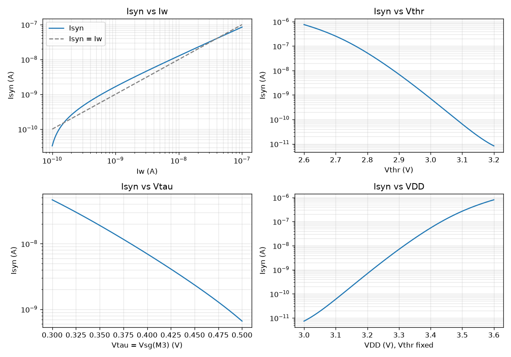
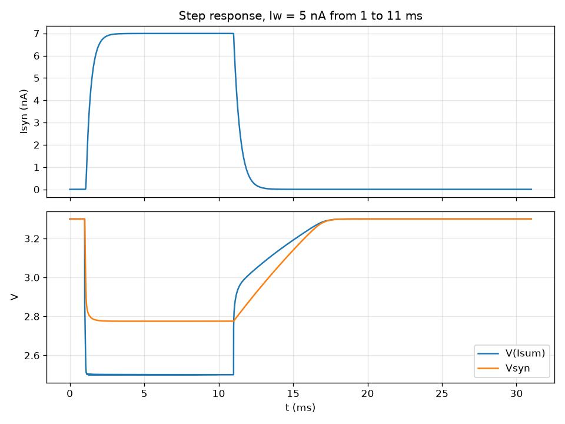
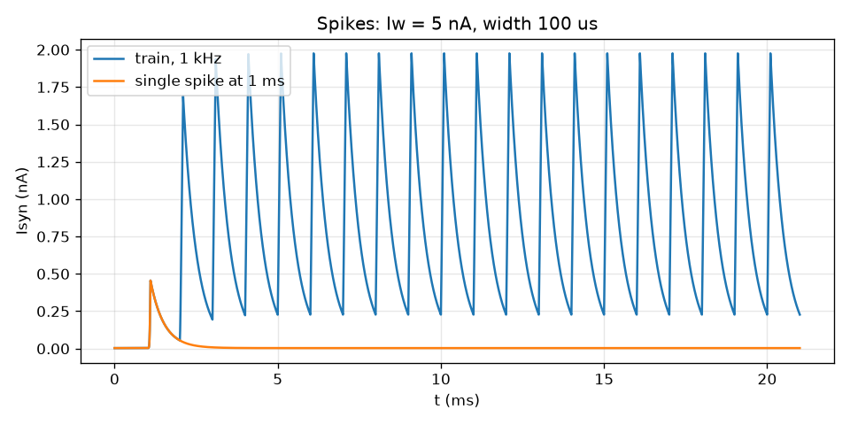
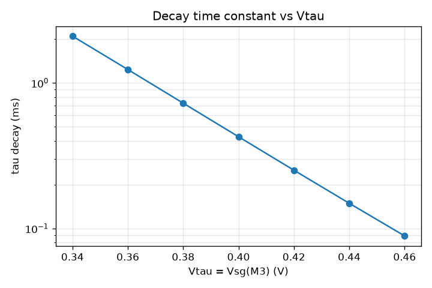
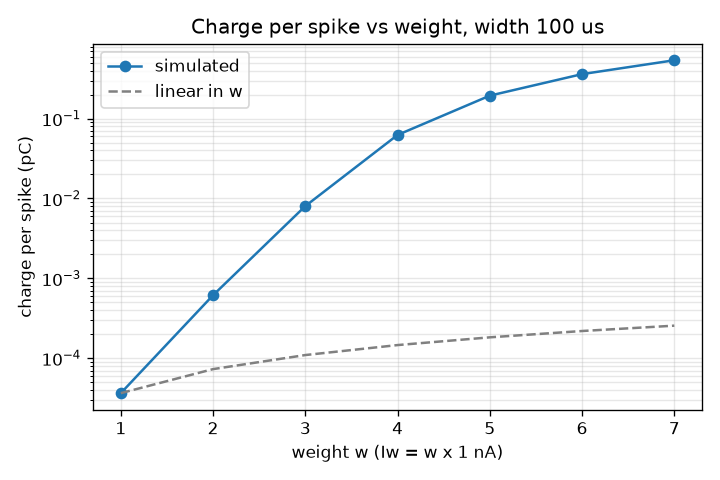
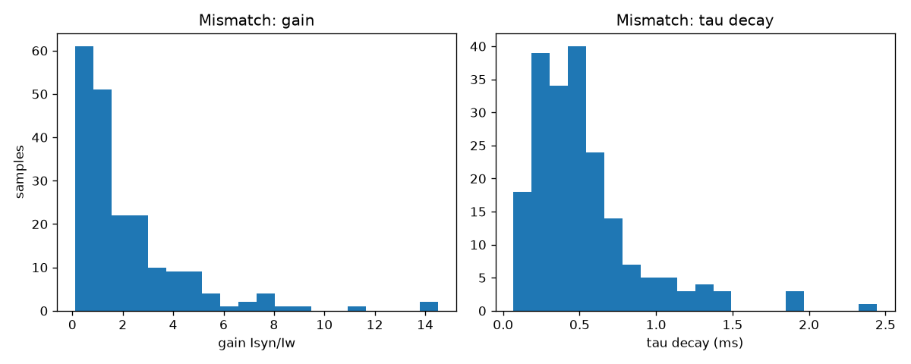

# DPI synapse testbench results

Generated by `run_dpi.py` on 2026-11-05 01:10 (ngspice-47 : Circuit level simulation program). Suites: nominal, tau, vthr, weight, width, rate, pvt, vdd, mc.

Reference bias: vdd = 3.3, vthr = 2.9, vtau = 0.4, iw = 5e-09, tpw = 0.0001, rate = 1000 (SI units). Targets marked *Check* are provisional; see `SPECS` in `run_dpi.py`.

## Nominal (tt, 27 C, reference bias)

| Metric | Value | Unit | Target | Check |
|---|---|---|---|---|
| Isyn at the reference point (`isyn_op`) | 6.997 | nA |  |  |
| Gain Isyn/Iw, DC (`gain_op`) | 1.399 |  | 0.5 to 3 | PASS |
| Supply current (`ivdd_op`) | 12 | nA |  |  |
| V(Isum), tail node (`vsum_op`) | 2.501 | V |  |  |
| Vsyn (gate of M4) (`vsyn_op`) | 2.775 | V |  |  |
| Log-log slope of Isyn vs Iw, 0.5-50 nA (`slope_iw`) | 0.8835 |  | 0.85 to 1.1 | PASS |
| Vthr change per decade of Isyn (`mvdec_vthr`) | 106.6 | mV/dec |  |  |
| Vtau change per decade of Isyn (`mvdec_vtau`) | 110.1 | mV/dec |  |  |
| VDD change per decade of Isyn, Vthr fixed (`mvdec_vdd`) | 105.5 | mV/dec |  |  |
| Isyn with Iw = 0 (`i_leak`) | 3.322 | pA | <= 20 pA | PASS |
| Isyn, steady state (`i_ss`) | 6.996 | nA |  |  |
| Gain Isyn/Iw, step (`gain`) | 1.399 |  |  |  |
| Change over the last 1 ms of the step (not settled if large) (`settle_err`) | 2.573e-06 |  | <= 0.01 | PASS |
| Rise time constant (63 %) (`tau_rise`) | 0.4032 | ms |  |  |
| 10-90 % rise time (`t_rise`) | 0.7349 | ms |  |  |
| Decay time constant (37 %) (`tau_fall`) | 0.4269 | ms | 0.2 to 1 ms | PASS |
| Decay shape: 13.5 % time / (2 tau), 1 = exponential (`exp_ratio`) | 0.9894 |  | 0.9 to 1.1 | PASS |
| Isyn 19 ms after release / Isyn at release (`residual`) | 0.0004748 |  | <= 0.01 | PASS |
| Lowest V(Isum) while Iw is on (`vsum_min`) | 2.5 | V | >= 0.5 V | PASS |
| Supply current while Iw is on (`ivdd_on`) | 12 | nA |  |  |
| Single-spike EPSC peak (`ipk1`) | 0.4552 | nA |  |  |
| Charge per spike (`q1`) | 0.1941 | pC |  |  |
| Same charge as a step on 0.86 pF (`dv_mem`) | 225.7 | mV |  |  |
| EPSC decay time constant (`tau_epsc`) | 0.4118 | ms |  |  |
| Mean Isyn, spike train (`iavg2`) | 0.8382 | nA |  |  |
| Train ripple, peak-to-peak / mean (`ripple`) | 2.086 |  |  |  |
| Train mean / (charge per spike x rate), 1 = linear (`lin_rate`) | 4.3 |  |  |  |
| Train peak / single-spike peak (`pk_ratio`) | 4.34 |  |  |  |

## Decay time constant vs Vtau (step test)

| vtau (V) | tau_fall (ms) | tau_rise (ms) | gain | i_ss (nA) | settle_err |
|---|---|---|---|---|---|
| 0.34 | 2.097 | 1.363 | 4.582 | 22.91 | 0.0006464 |
| 0.36 | 1.237 | 0.8876 | 3.133 | 15.67 | 2.617e-05 |
| 0.38 | 0.7266 | 0.5885 | 2.108 | 10.54 | 2.846e-06 |
| 0.4 | 0.4269 | 0.4032 | 1.399 | 6.996 | 2.573e-06 |
| 0.42 | 0.2516 | 0.2885 | 0.9156 | 4.578 | 2.403e-06 |
| 0.44 | 0.149 | 0.2179 | 0.5894 | 2.947 | 2.036e-06 |
| 0.46 | 0.08897 | 0.1748 | 0.3715 | 1.858 | 1.615e-06 |

## Gain vs Vthr (step test)

| vthr (V) | gain | i_ss (nA) | tau_fall (ms) | tau_rise (ms) | vsum_min (V) |
|---|---|---|---|---|---|
| 2.8 | 10.46 | 52.29 | 0.4692 | 0.371 | 2.403 |
| 2.85 | 3.984 | 19.92 | 0.4437 | 0.389 | 2.452 |
| 2.9 | 1.399 | 6.996 | 0.4269 | 0.4032 | 2.5 |
| 2.95 | 0.4595 | 2.297 | 0.4159 | 0.4152 | 2.548 |
| 3.0 | 0.1429 | 0.7143 | 0.4111 | 0.424 | 2.596 |

## Single spike vs weight (Iw = w x 1 nA, width 100 us)

The last tag column is 1 when the charge per spike is proportional to w.

| w | q / (w x q at w=1) | ipk1 (nA) | q1 (pC) | dv_mem (mV) | iavg2 (nA) | lin_rate |
|---|---|---|---|---|---|---|
| 1 | 1 | 0.003408 | 3.651e-05 | 0.04245 | 0.01923 | 435.7 |
| 2 | 8.42 | 0.004663 | 0.0006149 | 0.715 | 0.2517 | 404 |
| 3 | 73.4 | 0.02146 | 0.008035 | 9.343 | 0.4544 | 56.14 |
| 4 | 428 | 0.1486 | 0.0625 | 72.67 | 0.6486 | 10.32 |
| 5 | 1.06e+03 | 0.4552 | 0.1941 | 225.7 | 0.8382 | 4.3 |
| 6 | 1.65e+03 | 0.8368 | 0.361 | 419.7 | 1.022 | 2.822 |
| 7 | 2.11e+03 | 1.236 | 0.5386 | 626.3 | 1.204 | 2.23 |

## Single spike vs pulse width (Iw = 5 nA)

| tpw (us) | charge in (pC) | charge out / in | ipk1 (nA) | q1 (pC) | dv_mem (mV) | tau_epsc (ms) |
|---|---|---|---|---|---|---|
| 10 | 0.05 | 0.000142 | 0.003343 | 7.12e-06 | 0.008279 | 0.4126 |
| 20 | 0.1 | 0.0004 | 0.003421 | 4e-05 | 0.04651 | 0.437 |
| 50 | 0.25 | 0.00987 | 0.008877 | 0.002468 | 2.869 | 0.4358 |
| 100 | 0.5 | 0.388 | 0.4552 | 0.1941 | 225.7 | 0.4118 |
| 200 | 1 | 1.05 | 2.194 | 1.052 | 1223 | 0.4157 |
| 500 | 2.5 | 1.37 | 5.066 | 3.428 | 3986 | 0.423 |

## Spike train vs rate (Iw = 5 nA, width 100 us)

| rate (kHz) | iavg2 (nA) | ripple | lin_rate | pk_ratio |
|---|---|---|---|---|
| 0.25 | 0.0741 | 10.89 | 1.458 | 1.78 |
| 0.5 | 0.3449 | 4.339 | 3.519 | 3.329 |
| 1 | 0.8382 | 2.086 | 4.3 | 4.34 |
| 2 | 1.724 | 0.9381 | 4.431 | 5.767 |
| 5 | 3.937 | 0.2353 | 4.052 | 9.657 |

## Process corners and temperature (reference bias)

| corner | T (C) | settled | gain_op | i_ss (nA) | tau_fall (ms) | tau_rise (ms) | slope_iw | i_leak (pA) | q1 (pC) | lin_rate |
|---|---|---|---|---|---|---|---|---|---|---|
| tt | 0 | yes | 1.308 | 6.524 | 2.046 | 1.525 | 0.8547 | 3.315 | 0.211 | 4.434 |
| tt | 27 | yes | 1.399 | 6.996 | 0.4269 | 0.4032 | 0.8835 | 3.322 | 0.1941 | 4.3 |
| tt | 85 | yes | 1.257 | 6.283 | 0.03411 | 0.1421 | 2.052 | 3.976 | 0.06948 | 1 |
| ss | 0 | NO | 0.6667 | 1.085 | n/a | 5.48 | 0.8626 | 3.308 | 0.02673 | 6.564 |
| ss | 27 | NO | 1.009 | 3.952 | 7.919 | 4.104 | 0.8585 | 3.308 | 0.1188 | 5.145 |
| ss | 85 | yes | 1.227 | 6.135 | 0.4336 | 0.4196 | 0.8978 | 3.355 | 0.1681 | 4.138 |
| ff | 0 | yes | 1.709 | 8.547 | 0.0685 | 0.1493 | 1.755 | 3.343 | 0.1618 | 1.046 |
| ff | 27 | yes | 1.305 | 6.523 | 0.02044 | 0.1421 | 2.125 | 3.52 | 0.03058 | 1 |
| ff | 85 | yes | 0.003608 | 0.01804 | 0.00291 | 0.003739 | 1.8 | 13.73 | 0.000427 | 1 |
| sf | 0 | yes | 1.85 | 9.247 | 0.1655 | 0.2202 | 0.9617 | 3.326 | 0.2088 | 3.5 |
| sf | 27 | yes | 1.689 | 8.446 | 0.04382 | 0.1399 | 2.142 | 3.406 | 0.1143 | 1 |
| sf | 85 | yes | 0.00282 | 0.0141 | 0.0051 | 0.01001 | 1.933 | 8.544 | 0.0005294 | 1 |
| fs | 0 | NO | 0.6686 | 1.767 | 15.4 | 4.976 | 0.8529 | 3.311 | 0.05507 | 5.283 |
| fs | 27 | yes | 0.9114 | 4.371 | 3.653 | 2.626 | 0.8479 | 3.311 | 0.1588 | 4.022 |
| fs | 85 | yes | 1.128 | 5.64 | 0.2097 | 0.2587 | 0.9384 | 3.398 | 0.1518 | 3.141 |

## Supply (step test)

| VDD (V) | Vthr | i_ss (nA) | gain | tau_fall (ms) | settle_err |
|---|---|---|---|---|---|
| 3.0 | 2.9 V fixed | 0.007375 | 0.001475 | 0.4348 | 8.135e-07 |
| 3.0 | VDD - 0.4 V | 6.256 | 1.251 | 0.4248 | 2.558e-06 |
| 3.3 | 2.9 V fixed | 6.996 | 1.399 | 0.4269 | 2.573e-06 |
| 3.3 | VDD - 0.4 V | 6.996 | 1.399 | 0.4269 | 2.573e-06 |
| 3.6 | 2.9 V fixed | 796.9 | 159.4 | 0.7939 | 1.757e-06 |
| 3.6 | VDD - 0.4 V | 7.854 | 1.571 | 0.4291 | 2.419e-06 |

## Device mismatch (step test)

| Metric | Mean | Std dev | Std/mean | Min | Max | Unit |
|---|---|---|---|---|---|---|
| Isyn, steady state | 10.72 | 11.45 | 1.07 | 0.5626 | 72.61 | nA |
| Gain Isyn/Iw, step | 2.144 | 2.289 | 1.07 | 0.1125 | 14.52 |  |
| Decay time constant (37 %) | 0.5275 | 0.3656 | 0.69 | 0.06828 | 2.443 | ms |
| Rise time constant (63 %) | 0.4594 | 0.2293 | 0.50 | 0.1655 | 1.847 | ms |

200 of 200 samples simulated (tt, 27 C, mismatch only).

## Plots

