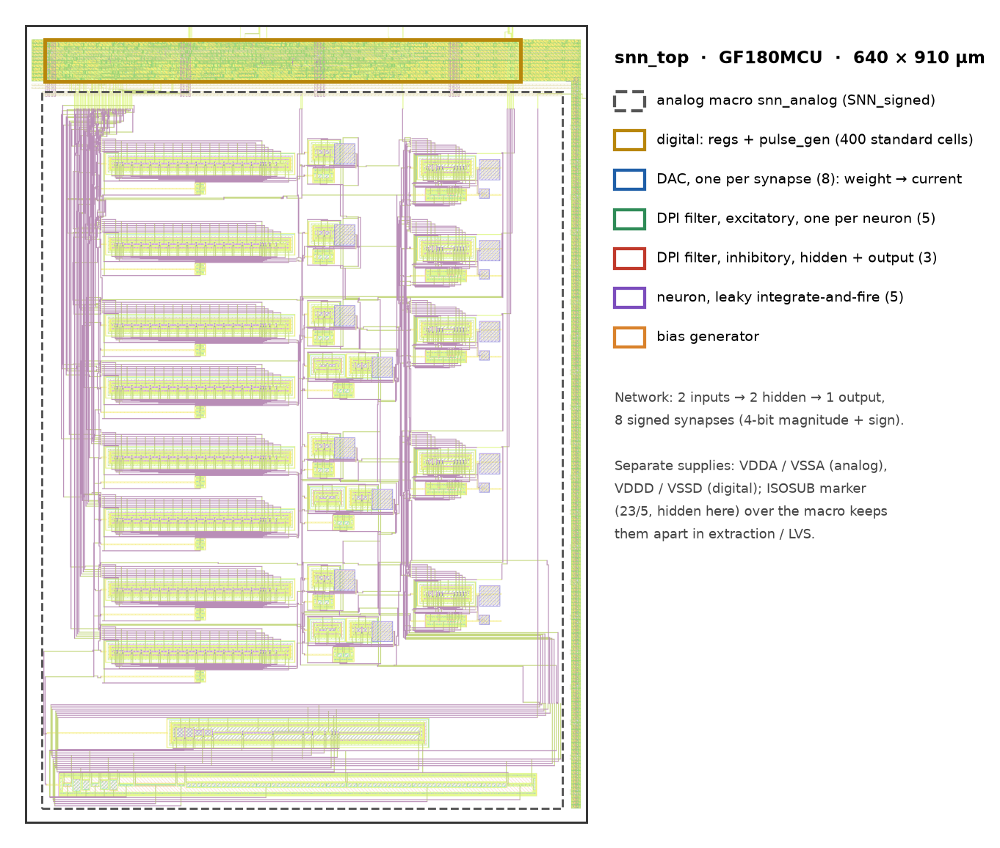
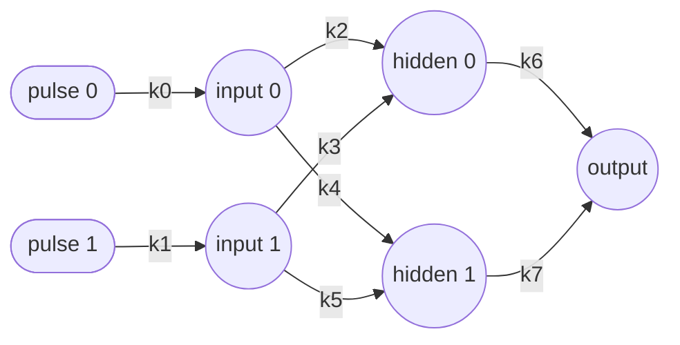
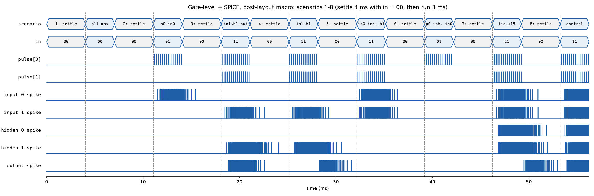
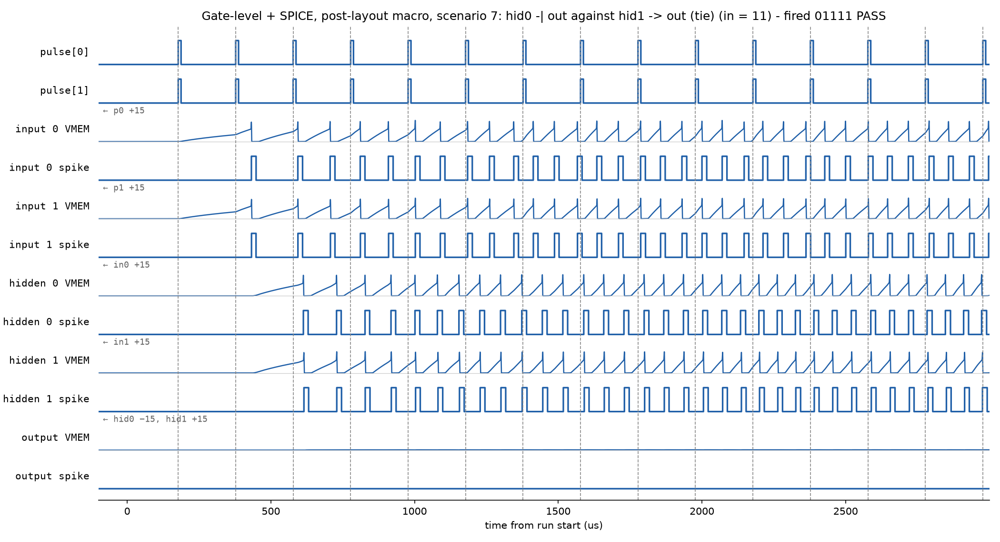

# snn_top: chip signoff

`snn_top` is a small mixed-signal spiking neural network for GF180MCU (3.3 V devices). It contains:

- an analog 2-2-1 network of leaky integrate-and-fire neurons with 8 signed synapses (4-bit magnitude plus a sign bit);
- the digital interface that loads the weights and generates the input spike trains.

The digital part (registers and pulse generator) is placed and routed with LibreLane. The analog network sits inside it as one hard macro (`snn_analog`, which wraps `SNN_signed`).

This page summarises the signoff state of the full chip, as published on this branch, and how to re-run every check.

| | |
|---|---|
| Layout | [`gds/snn_top.gds`](../gds/snn_top.gds) (640 × 910 µm, top cell `snn_top`) |
| Gate-level netlist | [`verilog/gl/snn_top.v`](../verilog/gl/snn_top.v) |
| Pins, supplies, power-up and test procedure | [`PINLIST.md`](../PINLIST.md) |
| LibreLane run | `RUN_2026-11-24_03-27-16` ([`librelane/snn_top/results/`](../librelane/snn_top/results)) |
| Collected results | [`signoff/results/`](results) (re-run with [`run_checks.sh`](run_checks.sh)) |

## Status at a glance

| Check | Result | Details |
|---|---|---|
| DRC, Magic (full deck) | ✅ 0 errors | [metrics](results/metrics.txt) |
| DRC, KLayout (741 rules incl. density) | ⚠️ 27 errors, all `DCF.1a` (COMP density): needs metal/COMP fill | [metrics](results/metrics.txt) |
| Antenna, power grid, max slew / cap / fanout | ✅ 0 violations | [metrics](results/metrics.txt) |
| Static timing, 9 corners (ss / tt / ff × min / nom / max RC), 1 MHz | ✅ no setup or hold violations | [metrics](results/metrics.txt) |
| Full-chip LVS, down to transistors | ✅ match, VSSA and VSSD kept separate | [chip_lvs](results/chip_lvs.txt) |
| Gate-level simulation, behavioral analog | ✅ PASS, 6 checks | [gls](results/gls.txt) |
| Gate-level timing simulation with SDF (zero-delay, ss, tt, ff) | ✅ PASS, 20 checks each | [gls_timing](results/gls_timing.txt) |
| Mixed-signal gate-level simulation, **post-layout** analog macro, scenarios 1–8 | ✅ PASS, all 8 | [gls_ms_pex](results/gls_ms_pex.txt) |
| Mixed-signal gate-level simulation, schematic analog macro, scenarios 1–8 | ✅ PASS, all 8 | [gls_ms](results/gls_ms.txt) |

Still open before tape-out: fill, the pad ring, and confirming with the organisers that their precheck accepts the `ISOSUB` marker layer (see [Open items](#open-items)).

## The chip



The analog macro takes up most of the die (0.49 of 0.58 mm²). The digital logic is the 400-cell strip along the top edge:

- `regs`: 14 four-bit registers holding the 8 weight magnitudes, the 8 sign bits, and the 8-bit pulse period and width, plus the 2-bit input enable register (address 14);
- `pulse_gen`: two input spike trains, by default one 10 µs pulse every 200 µs (5 kHz) from the 1 MHz clock.

The macro is placed flipped (`FS`), so its pin edge faces the digital strip. The 42 control wires (`w[31:0]`, `s[7:0]`, `pulse[1:0]`) enter it at the top left. The five spikes leave at the top right and go straight to the `out[4:0]` pins.

Inside the macro:

- each synapse has a **DAC** that turns its 4-bit weight into a current while the presynaptic spike is high;
- each neuron has one **DPI filter** that sums and smooths its excitatory DAC currents. Hidden and output neurons also have an inhibitory DPI that removes charge from the membrane;
- a **neuron** integrates against a leak and fires when its membrane reaches `VT`;
- a **bias generator** derives every bias from the one off-chip reference current `Iref`.



Synapse k has magnitude `w[4k+3:4k]` (0–15) and sign `s[k]` (1 = inhibitory). The input neurons have no inhibitory DPI, so a negative weight on k0 or k1 switches that synapse off.

**Separate analog and digital supplies.** `VDDA`/`VSSA` and `VDDD`/`VSSD` are separate nets and pads, so digital switching noise stays off the analog supply. Both grounds sit on the same p-substrate, and Magic's extraction would merge them through it. To prevent that, the macro carries an `ISOSUB` marker (GDS layer 23/5) over its footprint, kept 2 µm from the deep n-well. Only the PDK's LVS decks read this marker, and no mask is made from it.

Plain render without the labels: [`img/snn_top_layout.png`](img/snn_top_layout.png).

## Physical verification

- **DRC.** Magic DRC is clean. KLayout's deck (741 rules, density included) reports 27 errors, all `DCF.1a`, the minimum COMP density, because fill has not been added yet. The flow / glayout cell GDS and `SNN_signed.gds` use a
  0.005 µm database unit; the macro GDS LibreLane uses (`librelane/macros/snn_analog`) and the chip GDS use 0.001 µm.
- **LVS.** LibreLane's own LVS treats the analog macro as a black box, so it only checks the digital part. [`librelane/snn_top/chip_lvs.py`](../librelane/snn_top/chip_lvs.py) runs the full check:
  - it extracts the whole chip with Magic, down to every transistor of the macro;
  - it compares that with netgen against the gate-level netlist plus the macro's transistor-level reference;
  - result: *Circuits match uniquely* (962 pFETs, 2291 nFETs, 18 MIM capacitors in the macro), with the four supplies extracted as four separate nets.

  It also checks that every step of the build chain is up to date:
  - the macro's own DRC/LVS signoff;
  - the macro GDS used in the chip equals `SNN_signed.gds`;
  - the published GDS and netlist equal the LibreLane run.

  The "8 known port errors" in [the summary](results/chip_lvs.txt) are the isolated p-wells of the `Isum` nodes in the DAC/DPI cells. Magic exports them as macro ports, and at the top level they connect to nothing. The script accepts only these and fails on any other port error.
- **Antenna, power grid, max slew/cap/fanout:** 0 violations.

## Timing

1 MHz clock (1000 ns period). The project SDC ([`snn_top.sdc`](../librelane/snn_top/snn_top.sdc)) leaves `Iref` and `VT` untimed, since they are analog.

| Corner | Worst setup slack (ns) | Worst hold slack (ns) |
|---|---|---|
| ss, 125 °C, 3.0 V | 792.1 | 2.13 |
| tt, 25 °C, 3.3 V | 795.9 | 0.93 |
| ff, −40 °C, 3.6 V | 797.5 | 0.41 |

These are the worst values over min/nom/max parasitics; all 9 corners are in [metrics](results/metrics.txt). Setup slack is large because the clock is slow by design: the network runs at 5 kHz spikes, and 200 cycles of a 1 MHz clock give that rate within the 8-bit period register.

## Functional verification

Every test runs on the **gate-level netlist from the layout** (`verilog/gl/snn_top.v`), not the RTL:

| Test | What it checks | Where |
|---|---|---|
| Gate-level, behavioral analog | The RTL end-to-end testbench, unchanged, on the netlist, with a behavioral model of the network: register writes, pulse generation, spikes through to `out` | [`gls/`](../librelane/snn_top/gls) `make` |
| Gate-level timing | At the real 1 MHz clock: no pulses after reset until the input enables (register 14) are written, the pulse timing after reset and after reprogramming (period/width), that every weight and sign written arrives at the macro pins, and that a mid-run `rst` stops the pulses and keeps the weights. Run with zero delay and with the ss/tt/ff SDF back-annotated | [`gls/`](../librelane/snn_top/gls) `make timing`, [`tb_gls_timing.v`](../librelane/snn_top/gls/tb_gls_timing.v) |
| Mixed-signal gate-level | The netlist in Icarus Verilog and the analog macro in ngspice, coupled with SpiceBind. Eight network scenarios. Run once with the macro's **extracted layout parasitics** and once with its schematic netlist | [`gls_ms/`](../librelane/snn_top/gls_ms) `make run PEX=1` / `make run`, testbench [`mixed/snn_ms_tb.v`](../mixed/snn_ms_tb.v) |

### Network scenarios (mixed-signal, post-layout macro)

Each scenario loads weights and signs through the chip's register interface. It then waits 4 ms with `in = 00`, because the network has no reset pin. Next it enables the inputs for 3 ms (`in` is the input enable register, address 14) and checks which neurons fire. All synapses that are used have magnitude 15. tt, 27 °C, `Iref` = 100 nA, `VT` = 1.66 V.

Spike counts are over the 3 ms run window; times are the first spike after `in` is applied, including up to 200 µs of waiting for the next `pulse_gen` period. Expected and observed patterns are `{output, hidden 1, hidden 0, input 1, input 0}`.

| # | Weights (others 0) | `in` | Expected | Observed (post-layout) | Spikes: count (first, µs) |
|---|---|---|---|---|---|
| 1 | all 8 synapses +15 | 00 | `00000` nothing | ✅ `00000` | none |
| 2 | k0, k1 +15 (pulse → input only) | 01 | `00001` input 0 only | ✅ `00001` | in0 29 (424) |
| 3 | path in1 → hid1 → out: k1, k5, k7 +15 | 11 | `11010` | ✅ `11010` | in1 29 (380) → hid1 32 (571) → out 34 (746) |
| 4 | as 3, but hid1 → out (k7) = 0 | 11 | `01010` | ✅ `01010` | in1 30 (330) → hid1 32 (521) |
| 5 | as 3, plus k0 +15 and **in0 → hid1 (k4) −15**: excitation and inhibition cancel at hid1 | 11 | `00011` | ✅ `00011` | in0 36 (279), in1 36 (256); hid1, out silent |
| 6 | **pulse 0 → in0 (k0) −15**: inputs have no inhibitory DPI, so the synapse is off | 01 | `00000` | ✅ `00000` | none |
| 7 | k0, k1, k2, k5, k7 +15, **hid0 → out (k6) −15**: a +15 / −15 tie at the output | 11 | `01111` output silent | ✅ `01111` | in0 33 (394), in1 33 (394), hid0 35 (574), hid1 35 (576); out silent |
| 8 | control for 7: k6 = 0 | 11 | `11111` all fire | ✅ `11111` | in0 35 (359), in1 35 (359), hid0 35 (455), hid1 35 (542), out 37 (334\*) |

The same eight scenarios also pass with the schematic macro ([gls_ms](results/gls_ms.txt)). With the post-layout macro every neuron fires at the same time (within 1 µs) or earlier, by up to 123 µs (output in scenario 3; scenario 8's carry-over spike aside), which fits the faster post-layout input firing listed under [Open items](#open-items).



\* Scenario 8's first output spike (334 µs) is carry-over from scenario 7, not the tested path: the output membrane starts the window still charged and fires once before any input spike. It then fires from about 690 µs on, after hidden 1, as the path drives it ([scenario 8 plot](img/gls_ms_pex_scen8.png)).

Dashed lines mark the start of each run window. The network has no reset pin, so neurons can keep firing for a short time after a window ends. That's why the output also fires during the settle periods of scenarios 5 and 8: the hidden neurons are still active when the next scenario's weights are loaded. Every check counts spikes inside the run window only.

The tie in scenario 7 is the tightest case: hidden 1 drives the output with +15 and hidden 0 holds it back with −15. Here the output stays silent:



The other scenarios have the same per-scenario plots, showing membrane voltages and spikes: [`img/`](img).

Across process and mismatch, the analog-only testbench passes scenarios 5 and 7 in 93 of 100 post-layout Monte Carlo chips. The failures are 1–3 stray output spikes ([report](../analog/testbenches/snn/results/snn_signed_tb__pex__mc100.md)).

## Open items

- **Fill** for the 27 KLayout `DCF.1a` density errors. Until fill is added, LibreLane exits non-zero and `run.sh` skips its copy step.
- **`ISOSUB` marker (23/5):** confirm with the organisers that their precheck accepts it in the submitted GDS.
- **Pad ring** integration (21 pads, [`PINLIST.md`](../PINLIST.md)). Confirm the pad limit.
- **Analog behaviour after layout:** the input neurons fire about 2.7× as often as in the schematic. All 8 scenarios still pass ([diagnosis](../analog/testbenches/snn/results/snn_signed_pex_diagnosis.md)). A candidate fix is to steer the DAC current to VDD while the synapse is off, which would need a rebuild of the macro and the chip.
- **No membrane reset:** wait at least 8 ms with `in = 00` (register 14) between test cases on the chip ([`PINLIST.md`](../PINLIST.md) §5).

## Re-running the checks

From the repository root, inside the IIC-OSIC-TOOLS container:

```bash
signoff/run_checks.sh             # full-chip LVS + gate-level tests, about 5 min
signoff/run_checks.sh --spice     # also the post-layout mixed-signal run, about 11 min more
signoff/run_checks.sh --collect   # only refresh signoff/results/ from the last outputs
```

The script writes the verdict lines of each check, with the date and commit, to [`results/`](results) and a one-line-per-check summary to [`results/STATUS.txt`](results/STATUS.txt). It also redraws the plots in [`img/`](img) and exits non-zero if anything fails. To rebuild the chip itself after a design change, follow *After a design change* in the [main README](../README.md).
